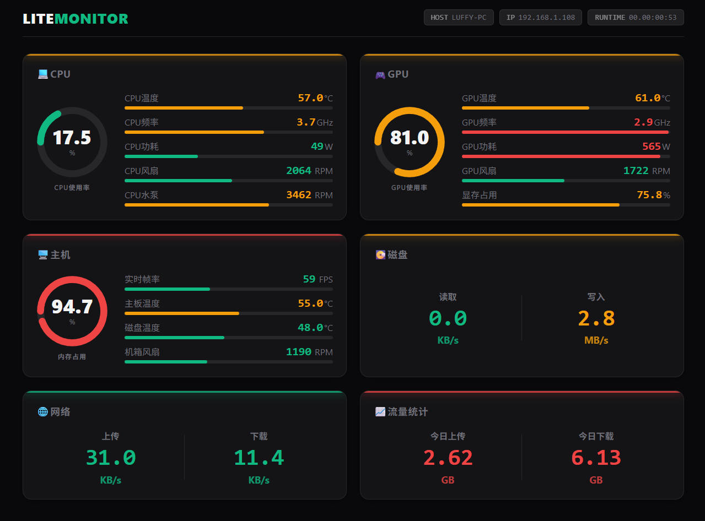

[English](./README.en.md)

#  LiteMonitor
一款轻量、可定制的开源桌面硬件监控软件 — 实时监测 CPU、GPU、内存、磁盘、网络等系统性能。

A lightweight and customizable desktop hardware monitoring tool — real-time monitoring of system performance such as CPU, GPU, memory, disk, and network.

支持横/竖屏/任务栏/网页显示、主题切换、多语言、透明度显示、三色报警等，界面简洁且高度可配置 。
> 🟢 **立即下载最新版本：** [📦 GitHub Releases → LiteMonitor 最新版](https://github.com/Diorser/LiteMonitor/releases/latest)    /  [⏬国内镜像网站下载](https://litemonitor.cn/)    

> 🟢 已支持【内存清理】和【自定义插件】功能，详见：[插件开发指南（无需编程）](./resources/plugins/PLUGIN_DEV_GUIDE.md#🔌-plugin-system)


###  🟢 横条模式 / 任务栏显示模式


# 🖥️ 系统监控功能

| 分类 | 监控指标 |
|------|-----------|
| 💻 **处理器（CPU）**  | 实时监测 CPU 使用率、温度、频率、功耗、风扇、水冷等数据。 |
| 🎮 **显卡（GPU）**  | 展示 GPU 使用率、核心温度、显存、频率、功耗 风扇，兼容 NVIDIA / AMD / Intel 显卡。 |
| 💾 **主机（HOST）** | 显示系统内存占用、虚拟内存（已提交内存）、FPS刷新率、磁盘温度、主板温度、机箱风扇等，清晰了解电脑综合情况。 |
| 🔋 **电池（Battery）** | 监测电池状态（充电状态、电量、功耗、电流、电压等）。 |
| 📀 **磁盘（Disk）**   | 监控磁盘读取与写入速度（KB/s、MB/s），帮助分析存储 I/O 活跃情况。支持自动/手动选择磁盘。 |
| 🌐 **网络（Network）** | 实时显示上传与下载速度（KB/s、MB/s），提供轻量级网络流量监控。支持自动/手动选择网卡。 |
| 📈 **流量统计（Traffic）** | 统计每日上传与下载流量，帮助分析网络使用习惯。 |
| 🔌 **插件系统（Plugin）** | 支持监控天气、股票、加密货币、代理延迟、汇率等，支持自定义插件，扩展监控项与功能。 |
| 🔧 **硬件传感器（Sensors）** | 硬件详情面板可以查看和监控所有系统硬件传感器数据。 |


> 💡 LiteMonitor 持续完善中，如需更多监控项或功能支持，欢迎在 [GitHub Issues](https://github.com/Diorser/LiteMonitor/issues) 中反馈建议！

---

###  🟢 网络测速功能 
  👉 


###  🟢 监控历史


###  🟢 历史流量统计


###  🟢 网页版监控

 
---

# 产品功能

| 功能 | 说明 |
|---|---|
| 🎨 自定义主题 | 通过 JSON 定义颜色、字体、间距、圆角等，主题可扩展与复用。主题系统 v2 更易维护。 |
| 🟥🟨🟩 **三色报警** | 监控项根据阈值自动切换进度条/数值颜色，支持自定义颜色与网络/磁盘独立阈值。 |
| 🌍 多语言界面 | 内置多语言，所有菜单/短标签/监控项即时国际化。 |
| 📊 监控项显示管理 | 按需显示或隐藏 CPU、GPU、VRAM、内存、磁盘、网络等模块。 |
| 🧮 **横屏模式** | 全新横条布局，支持每列独立宽度、单位智能格式化、两行显示、自动计算面板宽度。 |
| 📏 面板宽度调整 | 即时调整面板宽度，布局自动重排。 |
| 🔠 **UI 缩放** | 自适应 DPI + 用户自定义缩放，界面与字体完美比例缩放。 |
| 🎞️ **动画平滑** | 数值更新支持平滑动画，降低突变带来的跳动感，可自行调节速度。 |
| 🪟 窗口与界面 | 圆角显示、透明度调节、阴影、高质量字体渲染，视觉干净优雅。 |
| 🧭 靠边自动隐藏 | 靠屏幕边缘自动收起，靠近边缘自动弹出，支持多屏幕正确判断。 |
| 🧲 **限制拖出屏幕** | 选项开启后，窗口不可拖出屏幕可视区域。 |
| 👆 鼠标穿透模式 | 启用后，窗口不拦截鼠标事件，可直接操作背后应用。 |
| 🎨 UI 与主题即时切换 | 切换主题/语言后界面即时刷新，无需重启。 |
| 🔍 数值智能格式化 | 自动格式化单位与小数位，横屏模式支持智能“/s”去除、>=100 自动取整等。 |
| 🔄 自动更新检测 | 启动时静默检查新版本，手动检查时展示弹窗。支持国内与 GitHub 双源。 |
| 🚀 开机自启 | 通过计划任务方式实现管理员级别自启动。 |
| 📂 配置文件存储 | 所有设置实时写入 `settings.json`，支持迁移与备份。 |

---

## 📦 安装与使用

1. 前往 [Releases 页面](https://github.com/Diorser/LiteMonitor/releases) 下载最新版压缩包  
2. 解压后运行 `LiteMonitor.exe`  
3. 程序会自动根据系统语言加载对应语言文件

---

## 🎨 主题系统

主题文件位于 `/themes/` 目录。

示例：
```json
{
  "name": "DarkFlat_Classic",
  "layout": { "rowHeight": 40, "cornerRadius": 10 },
  "color": {
    "background": "#202225",
    "textPrimary": "#EAEAEA",
    "barLow": "#00C853"
  }
}
```

> ✨ 主题系统 v2 新特点：  
> - 布局字段更精简、统一  
> - 字体与布局分别独立缩放  
> - 所有布局由 Theme.Scale 自动处理  
> - 更容易构建自己的主题模板  

---

## ⚙️ 设置文件（settings.json）

| 字段 | 说明 |
|------|------|
| `Skin` | 当前主题名称 |
| `PanelWidth` | 面板宽度（支持横竖屏两种模式） |
| `UIScale` | 用户界面缩放倍率 |
| `Opacity` | 透明度（0.1 ~ 1.0） |
| `Language` | 当前语言（自动检测或手动切换） |
| `TopMost` | 是否置顶窗口 |
| `AutoStart` | 是否开机启动 |
| `AutoHide` | 是否启用靠边自动隐藏 |
| `ClampToScreen` | 拖动后限制窗口在屏幕内 |
| `ClickThrough` | 是否启用鼠标穿透 |
| `RefreshMs` | 刷新间隔（支持完整预设） |
| `AnimationSpeed` | 数值平滑动画速度 |
| `HorizontalMode` | 横屏/竖屏显示模式 |
| `PreferredNetwork` | 手动选择网卡（空=自动） |
| `PreferredDisk` | 手动选择磁盘（空=自动） |
| `Enabled` | 各监控项开关（CPU/GPU/MEM/NET/DISK） |

---

## 🧩 架构概览

| 文件 | 功能 |
|------|------|
| `MainForm_Transparent.cs` | 主窗体、拖拽、菜单托盘、自动隐藏、透明度、位置保存 |
| `UIController.cs` | 主题加载、DPI/UIScale 缩放、布局重构、渲染入口、定时刷新 |
| `UIRenderer.cs` | 竖屏渲染器（组块、进度条、标题渲染） |
| `HorizontalRenderer.cs` | 横屏渲染器（两行布局、智能标签与数值） |
| `UILayout.cs` | 竖屏动态布局计算 |
| `HorizontalLayout.cs` | 横屏列宽计算、面板总宽度计算 |
| `ThemeManager.cs` | 主题加载、颜色解析、字体构建 |
| `LanguageManager.cs` | 多语言加载、扁平化 Key 访问 |
| `HardwareMonitor.cs` | 采集 CPU/GPU/MEM/NET/DISK 信息；自动/手动设备选择 |
| `AutoStart.cs` | 管理计划任务，实现开机自启 |
| `UpdateChecker.cs` | GitHub + 国内双源版本检测 |
| `AboutForm.cs` | 关于窗口 |

---

## 🛠️ 编译说明

### 环境要求
- Windows 10 / 11  
- .NET 8 SDK  
- Visual Studio 2022 或 Rider

### 编译命令
```bash
git clone https://github.com/Diorser/LiteMonitor.git
cd LiteMonitor
dotnet build -c Release
```

输出文件：
```
/bin/Release/net8.0-windows/LiteMonitor.exe
```

---

## 📄 开源协议
本项目基于 **MIT License** 开源，可自由使用、修改与分发。

---

## 📬 联系方式
**作者**：Diorser  
**项目主页**：[https://github.com/Diorser/LiteMonitor](https://github.com/Diorser/LiteMonitor)
